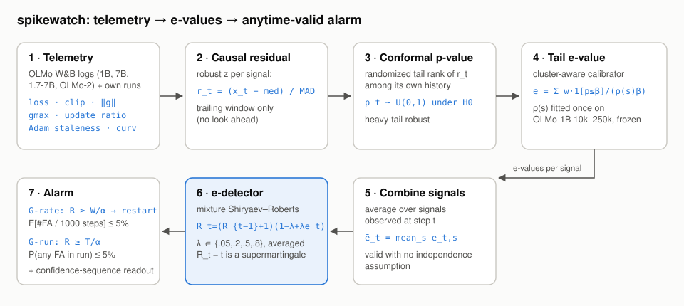
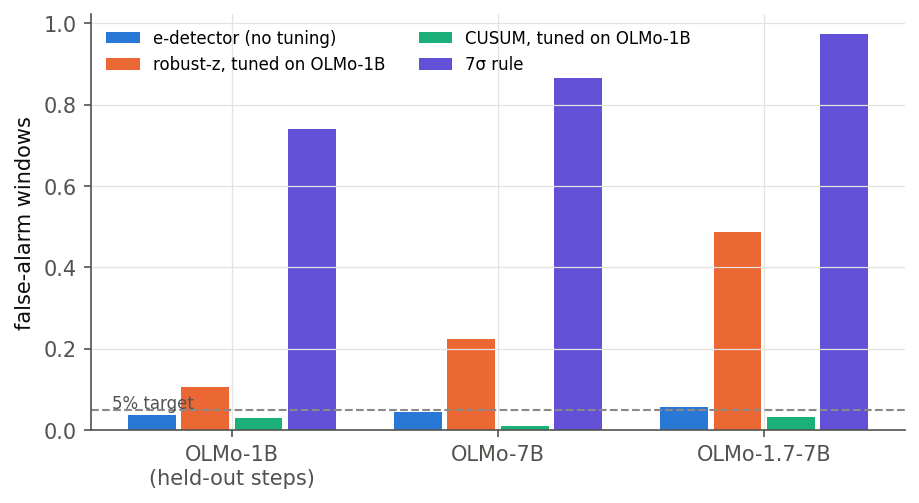
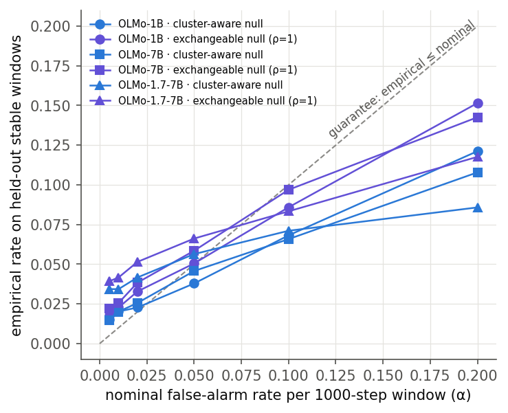
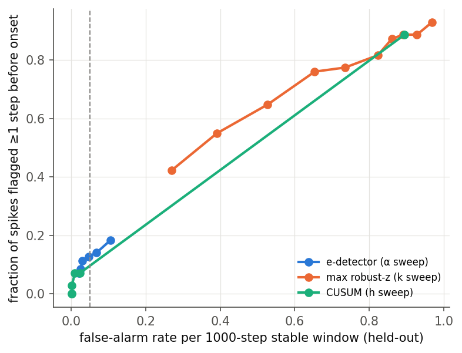
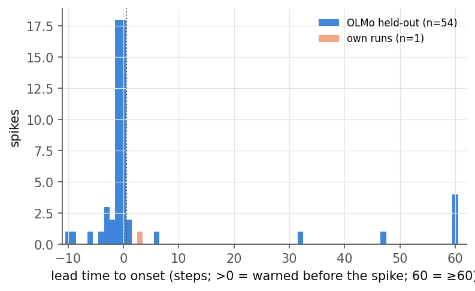
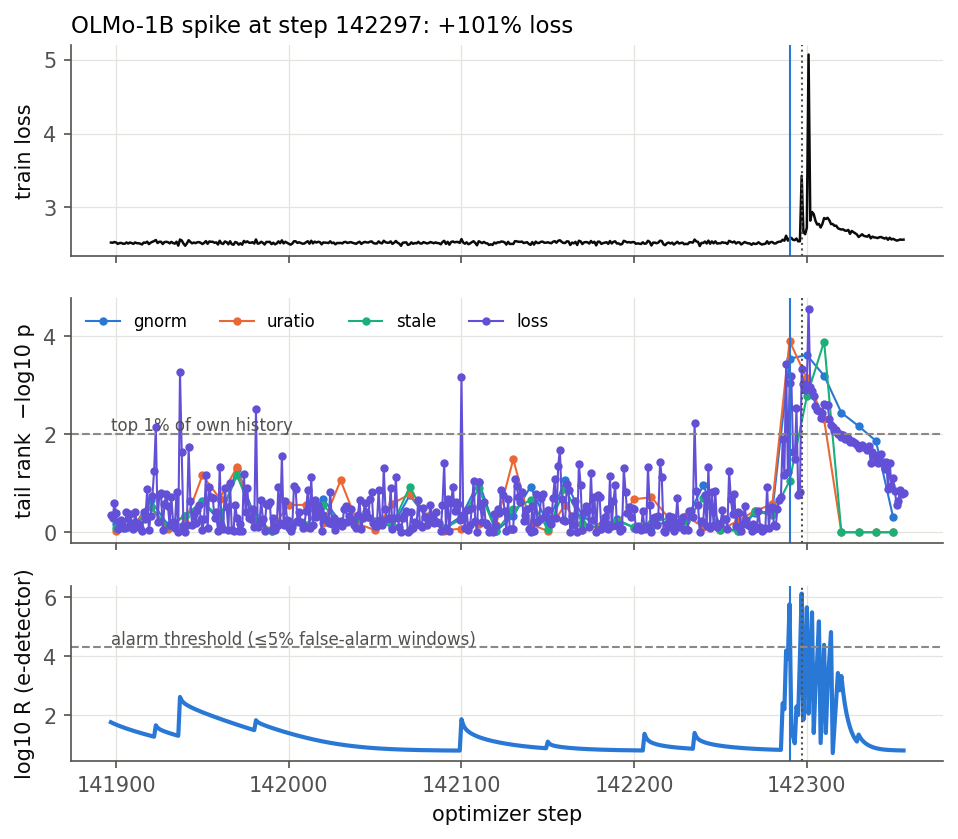

# LLM Training Loss-Spike Detection with Formal False-Alarm Guarantees

**spikewatch** is an early-warning monitor for loss spikes in large language model (LLM)
pretraining. It is built on **anytime-valid sequential hypothesis testing**: e-values,
e-processes, the Shiryaev–Roberts change detector, confidence sequences and conformal
p-values. It is evaluated under a **pre-registered protocol** on **1.7 million optimizer
steps** of public training telemetry from AI2's **OLMo** models (1B and 7B), plus a sweep of
29 small GPT runs trained for this project.

   

> **Result.** On 71 held-out OLMo loss spikes, with no per-model tuning, the detector caught
> **54 of 71 spikes** at a **4.7% pooled false-alarm rate** (3.8%, 4.6% and 5.6% of
> 1000-step windows on the three held-out series). The same thresholds tuned on OLMo-1B
> transfer to **10.6–48.8%** false alarms, and the common "7σ" rule to **74–97%**.
> Only **9 of 71** spikes were flagged *before* onset (median lead 0 steps). With optimizer
> statistics logged every 10 steps, these spikes give almost no advance signal.
> The pre-registered endpoint (FA ≤ 5% on every series and ≥ 50% flagged early) was
> **not met**, and that is reported as is.



---

## Why this matters

Loss spikes and divergences cost large pretraining runs days of compute: rollbacks, skipped
batches and restarts. Production monitors are hand-set thresholds such as "alarm if grad-norm
> 7σ". They are tuned by eye on one run, they say nothing about how often they will page
someone for nothing, and their calibration silently breaks on the next model.

This project treats spike detection as a **statistical testing problem**:

* **The false-alarm rate is a theorem, not a tuning result.** Under a stated null, the expected
  number of false alarms per 1000 steps is ≤ α. This holds at every stopping time, with
  continuous monitoring and no multiple-testing correction.
* **The calibration transfers.** The null is fitted once on OLMo-1B and applied unchanged to
  OLMo-7B and OLMo-1.7-7B (different model size, data mix and run).
* **Every alarm can be explained.** Each alarm corresponds to a time-uniform confidence
  sequence for a signal's tail-exceedance rate leaving its null range.

## Method

| Stage | What it does | Implementation |
|---|---|---|
| Telemetry | Signals: loss, gradient-clip rate, global grad norm, max per-tensor grad ratio, Adam **update ratio**, second-moment **staleness**, secant **loss curvature**. Derived from OLMo's per-tensor W&B norms | [`olmo.py`](src/spikewatch/olmo.py) |
| Causal residual | Robust z (median / MAD) over a trailing window, with no look-ahead | [`evalues.py`](src/spikewatch/evalues.py) |
| Conformal p-value | Randomized tail rank of the residual within its own history; uniform under exchangeability and robust to heavy tails | [`evalues.py`](src/spikewatch/evalues.py) |
| Tail e-value | Bounded calibrator `e = Σ_k w_k 1[p ≤ β_k] / (ρ_k(s) β_k)`, β = 1%, 0.3%, 0.1% | [`evalues.py`](src/spikewatch/evalues.py) |
| Cluster-aware null | Tail events cluster in real telemetry, so inflation up to ρ(s) is allowed, where the state s means "a tail event in the last 5 observations". Fitted with Clopper–Pearson bounds | [`audit.py`](src/spikewatch/audit.py) |
| Signal fusion | Average of e-values over the signals observed at step t. Valid with **no independence assumption** | [`detector.py`](src/spikewatch/detector.py) |
| e-detector | Mixture Shiryaev–Roberts `R_t = (R_{t-1}+1)(1-λ+λ e_t)`, mixed over λ; vectorized log-space closed form | [`detector.py`](src/spikewatch/detector.py) |

**Guarantees.** These are proved in the [`detector.py`](src/spikewatch/detector.py) docstring
and checked by simulation in [`tests/test_validity.py`](tests/test_validity.py).

| Mode | Alarm rule | Guarantee under H0 |
|---|---|---|
| **G-rate** (primary) | `R_t ≥ W/α`, then restart | E[# false alarms per W steps] ≤ α, so P(a 1000-step window has a false alarm) ≤ 5% |
| **G-run** | `R_t ≥ T/α` | P(any false alarm in a T-step run) ≤ 5% (Ville's inequality) |

## Results

All numbers below are generated by [`scripts/make_report.py`](scripts/make_report.py) into
[`results/RESULTS.md`](results/RESULTS.md). The calibration and the baseline thresholds were
fitted on OLMo-1B steps 10k–250k only, and every other series is held out.

### Primary endpoint (held-out OLMo, G-rate, α = 5% per 1000-step window)

| Held-out series | Steps | Spikes M | Detected N | Flagged before onset | Window FA rate (95% CI) |
|---|---|---|---|---|---|
| OLMo-1B, steps > 250k | 397k | 0 | – | – | **3.8%** (15/396; 2.1–6.2%) |
| OLMo-7B | 569k | 8 | 6 | 1 | **4.6%** (25/547; 3.0–6.7%) |
| OLMo-1.7-7B | 474k | 63 | 48 | 8 | **5.6%** (23/408; 3.6–8.3%) |
| **Pooled** | 1.44M | **71** | **54 (76%)** | **9 (13%)** | **4.7%** (63/1351) |
| OLMo-2-7B stage 1 | – | *pending: telemetry download incomplete* | | | |

**Verdict against the pre-registration: NOT MET.** OLMo-1.7-7B came in at 5.6%, just above
the 5% bar (the 95% CI includes 5%). Early warning reached 13%, against a bar of 50%.

### Comparison with threshold baselines (held-out, pooled)

| Detector | Tuned on OLMo-1B? | Detected | Before onset | Pooled FA | Worst series FA | Formal guarantee |
|---|---|---|---|---|---|---|
| **e-detector, G-rate** | ρ only | 54/71 | 9 | **4.7%** | 5.6% | ✅ under H0(ρ) |
| e-detector, G-run | ρ only | 39/71 | 5 | **1.2%** | 2.5% | ✅ under H0(ρ) |
| e-detector, exchangeable null (ρ = 1) | – | 54/71 | 10 | 5.8% | 6.6% | ✅ under exchangeability (violated) |
| Max robust-z, k = 30 | ✅ | 62/71 | 30 | 26.9% | **48.8%** | ❌ |
| "7σ" rule | – | 71/71 | 62 | 86.1% | **97.3%** | ❌ |
| Page CUSUM, h = 10 | ✅ | 55/71 | 5 | 2.3% | 3.2% | ❌ |



The z-threshold looks just as good as the e-detector on its tuning split (2.5% vs 2.1% FA),
then degrades by up to 20× on new runs. The e-detector holds near its nominal level with no
re-tuning. A tuned CUSUM also transferred well on this data, but it has no guarantee and
flagged fewer spikes early.

### Is the guarantee honest? Empirical vs nominal false-alarm rate



Across α from 0.5% to 20%, the cluster-aware null is at or below nominal for α ≥ 10% on every
series, and within about 1 point of nominal at α = 5%. It is **anti-conservative at very small α** (for example 3.4% observed at a nominal
0.5% on OLMo-1.7-7B), because ρ(s) was estimated on a different model. The exchangeable
null (ρ = 1) is worse throughout.

### Early detection vs false alarms





Most detections land within a few steps of onset. On OLMo the layer-wise optimizer statistics
are logged every 10 steps, and on their own they lag the loss (median lead −4 to −7 steps on
the calibration split). **Scientific takeaway:** at this logging cadence, these OLMo spikes are
abrupt. The detector reliably reports them within a few steps, with controlled false alarms,
but the logged telemetry carries little *predictive* signal.

### Case study: OLMo-1B spike at step 142,297 (+101% loss)



### Signal ablation (held-out, pooled; each signal alone)

| Signal | loss | clip | grad norm | grad max | update ratio | staleness | curvature | all (fused) |
|---|---|---|---|---|---|---|---|---|
| Detected / 71 | 46 | 17 | 21 | 17 | 1 | 11 | 6 | **54** |
| Pooled FA | 4.5% | 3.5% | 3.3% | 2.9% | 1.6% | 1.8% | 1.1% | 4.7% |

### Own runs: small GPT with exact per-step telemetry

29 byte-level GPT runs (Post-LN, no gradient clipping, lr 4e-3 to 1e-2, β2 ∈ {0.95, 0.999},
3 seeds) log exact per-step update ratio, Adam staleness, secant curvature and logit max.
ρ was fitted on the 5 lr = 1e-3 control runs. The unstable runs produced only **1** major
spike after the arm step, which was **detected 3 steps before onset**. The window FA rate was
9.8% (4/41 windows; binomial p = 0.15 against 5%). The tuned z-threshold reached 24% and the
7σ rule 90%. Several of the "false" alarms coincide with real 20–715× gradient-norm blow-ups
whose loss bumps stayed below the spike threshold.

## Limitations

* **Early warning is weak** on OLMo telemetry at a 10-step logging cadence. The guarantee
  controls false alarms; it does not create lead time that the signals do not carry.
* **The guarantee is conditional on ρ(s)**, a cluster-aware null fitted on another model. It
  transferred to within about 1 point of nominal at α = 5%, but not at very small α.
* **OLMo-2-7B is not yet scored**: its W&B telemetry download repeatedly stalled. It will be
  added without re-tuning.
* The own-runs arm produced too few spikes to estimate power. It mainly serves as a
  false-alarm audit on exact telemetry.

## Reproduce

```powershell
python -m pip install -e .[fetch,train,dev]
python -m pytest -q                                    # 12 validity tests (G-run, G-rate, calibrator, CS)
python scripts/fetch_olmo.py ai2-llm/OLMo-1B           # also: ai2-llm/OLMo-7B --prefix OLMo-7B-run / OLMo-1.7-7B-run
python -W ignore scripts/run_olmo_eval.py --calibrate  # fit ρ on OLMo-1B 10k–250k, score held-out series
bash scripts/sweep_small.sh                            # 29 small GPT runs (~1.5 GPU-hours on a T1000)
python -W ignore scripts/run_small_eval.py
python -W ignore scripts/make_figures.py
python scripts/make_report.py                          # writes results/RESULTS.md
```

The pre-registration, frozen before any held-out data was scored, and its two logged
deviations are in [`docs/PREREGISTRATION.md`](docs/PREREGISTRATION.md).

## Repository layout

```
src/spikewatch/
  evalues.py      causal robust residuals, conformal p-values, tail and cluster-aware e-value calibrators
  detector.py     mixture Shiryaev–Roberts e-detector (vectorized), thresholds, e-value fusion, confidence sequences
  olmo.py         OLMo W&B telemetry -> per-step signals (update ratio, Adam staleness, curvature)
  labels.py       loss-spike and divergence labeler (major / minor tiers)
  metrics.py      lead time, detection and window false-alarm scoring
  baselines.py    robust z-threshold and Page CUSUM
  audit.py        tail-inflation audit and rho(s) fitting
  experiment.py   the pre-registered protocol as code
scripts/          data fetch, small-GPT training (PyTorch), sweep, evaluation, figures, report
tests/            simulation tests of every guarantee
docs/             pre-registration
results/, figures/
```

## Skills demonstrated

Sequential hypothesis testing · e-values and e-processes · anytime-valid inference ·
confidence sequences · conformal prediction · change-point detection (Shiryaev–Roberts, CUSUM)
· anomaly detection on time series · LLM pretraining stability (loss spikes, Adam dynamics,
gradient norms) · PyTorch model training and instrumentation · Weights & Biases API data
engineering (1.7M steps) · NumPy / pandas / SciPy vectorization · pre-registered experimental
design · statistical validation with pytest · data visualization (matplotlib).

## References

Ramdas, Grünwald, Vovk & Shafer, *Game-theoretic statistics and safe anytime-valid inference*
(2023) · Shin, Ramdas & Rinaldo, *E-detectors: a nonparametric framework for sequential
change detection* (2023) · Waudby-Smith & Ramdas, *Estimating means of bounded random
variables by betting* (2023) · Vovk & Wang, *E-values: calibration, combination and
applications* (2021) · Groeneveld et al., *OLMo* (2024) · Wortsman et al., *Small-scale
proxies for large-scale Transformer training instabilities* (2023).

---

Author: **Archana Suresh Patil** · Python · PyTorch · Statistics · MLOps
